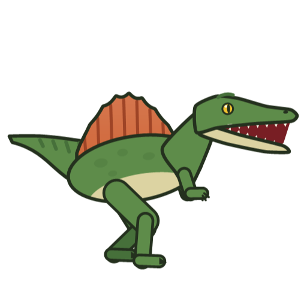
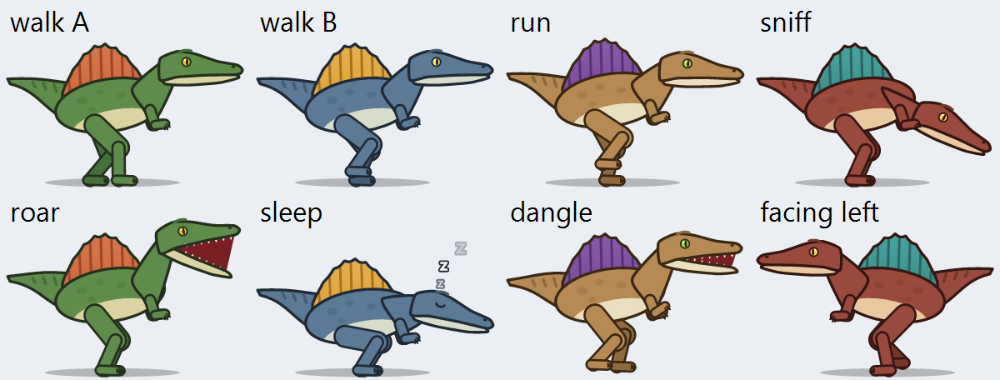

# Sailback

A little sail-backed dinosaur that lives on your Windows taskbar. It wanders back and forth, sniffs around, roars, naps, and bolts when the mouse gets too close.



Sailback is a modern, from-scratch take on the 2001-era "desktop dinosaur" toys that came with kids' PC games. Those old toys still run on Windows 11, but they don't work well. They aren't DPI-aware, so they come out blurry or the wrong size. Their windows have hard, jagged edges. Nothing keeps them above the taskbar, and you can't close them from a tray icon. Sailback does the same job with current Windows APIs. All of its art and sound is original and generated in code.

## Download / run

Grab **[`release/Sailback.exe`](release/Sailback.exe)** and double-click it. It's a single small file with no installer. It runs on .NET Framework 4.8, which is built into Windows 10 (1903+) and Windows 11.

> Windows SmartScreen may warn the first time, because the exe isn't code-signed. Choose **More info → Run anyway**.

## Playing with it

| Do this | It does this |
|---|---|
| Click the dino | Roars |
| Double-click | Roars, then bolts |
| Drag it | Picks it up (legs kicking) |
| Fling it | It flies, bounces off screen edges and lands on its feet |
| Move the mouse toward it | It often runs away |
| Leave it alone | It wanders, sniffs, and eventually naps (zzz) |
| Right-click the dino or the tray icon | Opens the options menu |
| Run `Sailback.exe` again | Drops another dino from the sky (up to 8, each in its own colors) |

### Options (right-click menu)

- **Roar! / Run! / Nap time**: trigger an action.
- **Add another dino / Send this dino home**: change how many dinos there are.
- **Size**: Small, Medium, Large or Huge, scaled for each monitor's DPI.
- **Sounds**: the roar is synthesized at startup; no audio files are shipped.
- **Run away from the mouse**
- **Always on top**: stays above windows and the taskbar.
- **Hide during full-screen apps**: gets out of the way of games and videos.
- **Start with Windows**: per-user, no admin rights needed.
- **Exit**

Settings are saved in `HKCU\Software\Sailback`.

## How it works

- Each dino is a borderless **per-pixel-alpha layered window** (`UpdateLayeredWindow`). Edges are anti-aliased, and transparent pixels are click-through, so it never gets in the way of the desktop.
- The window is `WS_EX_TOOLWINDOW | WS_EX_NOACTIVATE`. It has no taskbar button and never steals focus from what you're typing in.
- The process is **Per-Monitor V2 DPI aware**. The dino is drawn as vectors (GDI+) and re-scaled when it walks onto a monitor with a different DPI.
- It walks across all monitors and stands on the top edge of each one's taskbar (the working area), wherever the taskbar is.
- Animation runs from a single ~60 fps timer. Leg poses use two-bone inverse kinematics, so the feet stay planted while walking.

## Building

Needs the .NET SDK (any recent version; it targets `net48` via reference-assembly packages).

```powershell
dotnet build src -c Release -o out/build
copy out\build\Sailback.exe release\
```

Dev helpers built into the exe:

```powershell
Sailback.exe --export-icon src\Sailback.ico   # regenerate the app icon from the vector art
Sailback.exe --export-png  docs\sailback.png  # hero image
Sailback.exe --export-sheet docs\poses.png    # every animation pose on one sheet
```



## Project layout

```
src/
  Program.cs       entry point, single-instance handling, dev export commands
  SailbackApp.cs   tray icon, menu, animation clock, full-screen detection
  Dino.cs          one dinosaur: layered window, behaviour state machine, mouse handling
  DinoArt.cs       procedural vector art and colour palettes
  RoarSynth.cs     synthesised roar (WAV generated in memory)
  Settings.cs      registry-backed preferences, start-with-Windows
  Native.cs        Win32 interop
release/
  Sailback.exe     prebuilt binary
```
