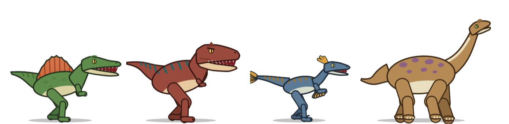
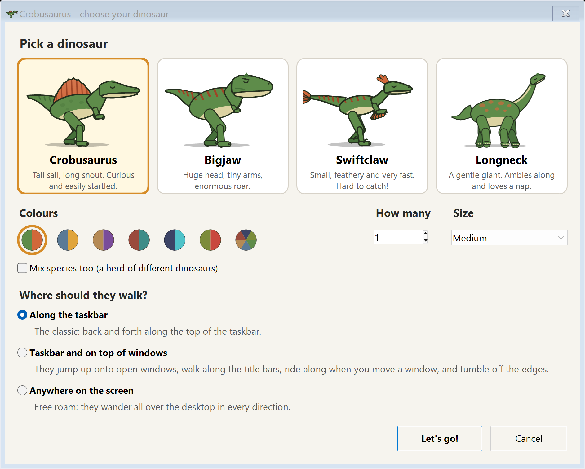

# Crobusaurus

Little dinosaurs that live on your Windows desktop. They wander along the taskbar, hop onto your windows, or roam the whole screen. Along the way they sniff around, roar, nap, and bolt when the mouse gets too close.



Crobusaurus is a modern, from-scratch take on the 2001-era "desktop dinosaur" toys that came with kids' PC games. Those old toys still run on Windows 11, but they don't work well. They aren't DPI-aware, so they come out blurry or the wrong size. Their windows have hard, jagged edges. Nothing keeps them above the taskbar, and you can't close them from a tray icon. Crobusaurus does the same job with current Windows APIs. All of its art and sound is original and generated in code.

## Download / run

Grab **[`release/Crobusaurus.exe`](release/Crobusaurus.exe)** and double-click it. It's a single small file with no installer. It runs on .NET Framework 4.8, which is built into Windows 10 (1903+) and Windows 11.

> Windows SmartScreen may warn the first time, because the exe isn't code-signed. Choose **More info → Run anyway**.

On first launch you get the **Choose your dinosaur** window:



To open it again later, double-click the tray icon, choose **Choose dinosaur...** from the right-click menu, or run `Crobusaurus.exe --pick`.

## The dinosaurs

| | Species | Personality |
|---|---|---|
| 🦖 | **Crobusaurus** | The mascot. Tall sail and a long snout. Curious and easily startled. |
| 🦖 | **Bigjaw** | Huge head, tiny arms, enormous roar. Slow and heavy. |
| 🦖 | **Swiftclaw** | Small, feathered and very fast. Hard to catch. |
| 🦕 | **Longneck** | A gentle four-legged giant. Ambles along and loves a nap. |

Each species has its own size, gait speed and voice. There are six colour schemes (Fern, Slate, Dune, Ember, Midnight, Moss), plus a **Mixed** option that gives every dino in a herd different colours. Tick **Mix species too** for a herd of different dinosaurs.

## Where they walk

| Mode | What happens |
|---|---|
| **Along the taskbar** | The classic: back and forth along the top edge of the taskbar. |
| **Taskbar and on top of windows** | Dinos jump up onto open windows and walk along their title bars. If you drag the window, they ride along with it. At the edges they turn back or tumble off. Maximized and covered window edges don't count. |
| **Anywhere on the screen** | Free roam: they wander all over the desktop in every direction. |

You can switch modes at any time from **Where to walk** in the right-click menu.

## Playing with them

| Do this | It does this |
|---|---|
| Click a dino | Roars |
| Double-click | Roars, then bolts |
| Drag it | Picks it up (legs kicking) |
| Fling it | It flies, bounces off screen edges and lands on its feet (or on a window) |
| Move the mouse toward it | It often runs away |
| Leave it alone | It wanders, sniffs, and eventually naps (zzz) |
| Right-click a dino | Change that dino's species or colours, plus all the options |
| Right-click the tray icon | Options for the whole herd |
| Run `Crobusaurus.exe` again | Drops another dino from the sky (up to 8) |

Other options in the menu: Size (Small, Medium, Large or Huge, scaled per monitor DPI), Sounds, Run away from the mouse, Always on top, Hide during full-screen apps, and Start with Windows (per-user, no admin rights needed). Settings are saved in `HKCU\Software\Crobusaurus`.

## Name history

The project started out as **Sailback**, named after the sail of spines along the mascot's back ("sailback" is also an informal word for sail-backed animals like Spinosaurus and Dimetrodon). Both the app and the sail-backed species were renamed **Crobusaurus** in November 2026. *Sailback* is worth keeping in mind as an alternative name, for example for a second sail-backed species or a future spin-off.

## How it works

- Each dino is a borderless **per-pixel-alpha layered window** (`UpdateLayeredWindow`). GDI+ draws straight into a reusable DIB section. Edges are anti-aliased, transparent pixels are click-through, and the window (`WS_EX_TOOLWINDOW | WS_EX_NOACTIVATE`) never steals focus or adds a taskbar button.
- The process is **Per-Monitor V2 DPI aware**. All art is vector-drawn, so it stays sharp at any scale and re-scales when a dino walks onto a monitor with a different DPI.
- Leg poses use two-bone inverse kinematics, so the feet stay planted while walking.
- In window-walking mode the app takes a snapshot of the visible top-level windows in z-order 10 times a second. It skips cloaked windows (other virtual desktops), minimized and maximized windows, and click-through overlays, and counts only the parts of each top edge that aren't covered. Window platforms are one-way: dinos can jump up through them and land on top. Jumps are ballistic arcs aimed at a reachable window.
- Roars are synthesised in memory at a pitch that suits each species, so no audio files are shipped.

## Building

Needs the .NET SDK (any recent version; it targets `net48` via reference-assembly packages).

```powershell
dotnet build src -c Release -o out/build
copy out\build\Crobusaurus.exe release\
```

Developer helpers built into the exe:

```powershell
Crobusaurus.exe --pick                              # open the chooser on launch
Crobusaurus.exe --export-icon   src\Crobusaurus.ico    # regenerate the app icon from the vector art
Crobusaurus.exe --export-lineup docs\lineup.png     # all species side by side
Crobusaurus.exe --export-sheet  docs\poses.png      # every species in every pose
Crobusaurus.exe --export-picker docs\picker.png     # screenshot of the chooser
Crobusaurus.exe --dump-surfaces surfaces.txt        # which windows count as walkable right now
```


## Project layout

```
src/
  Program.cs          entry point, single-instance handling, developer export commands
  CrobusaurusApp.cs      tray icon, menus, animation clock, full-screen detection
  PickerForm.cs       the "choose your dinosaur" window
  Dino.cs             one dinosaur: layered window, behaviour state machine, walking modes, mouse
  Surfaces.cs         walkable window edges (window-walking mode)
  Art.cs              palettes, pose model, Species base class, shared drawing helpers
  Species/*.cs        Crobusaurus, Bigjaw, Swiftclaw, Longneck
  RoarSynth.cs        synthesised roars
  Settings.cs         registry-backed preferences, start-with-Windows
  Native.cs           Win32 interop
release/
  Crobusaurus.exe        prebuilt binary
```
